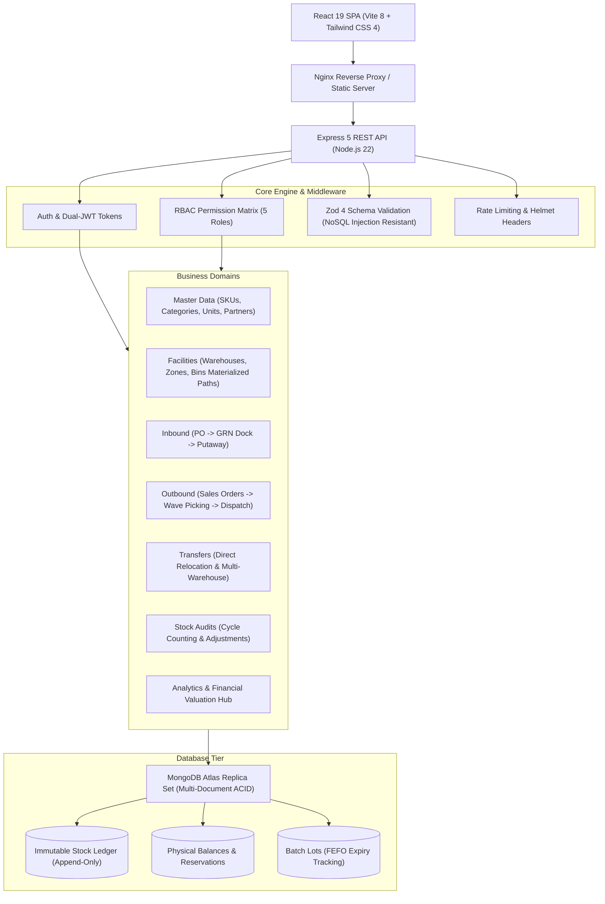

# StockPilot WMS - Enterprise Warehouse Management System

[](https://github.com/stockpilot-wms/stockpilot)
[](https://nodejs.org/)
[](https://react.dev/)
[](https://expressjs.com/)
[](https://tailwindcss.com/)
[](https://opensource.org/licenses/MIT)

StockPilot WMS is a multi-warehouse inventory and operations management platform designed for distribution centers, manufacturing warehouses, and e-commerce fulfillment hubs. Built on an **immutable double-entry stock ledger** architecture with strict ACID transaction guarantees.

---

## 1. System Architecture



---

## 2. Core Functional Modules

- **Immutable Stock Ledger**: All quantity movements pass through atomic ledger postings (`PURCHASE_RECEIPT`, `PUTAWAY`, `SALES_ISSUE`, `TRANSFER_OUT`, `TRANSFER_IN`, `ADJUSTMENT_GAIN`, `ADJUSTMENT_LOSS`, `WRITE_OFF`). Direct database manipulation of balance quantities is prohibited.
- **Facility Materialized Paths**: Hierarchical location modeling (`WH-MAIN/ZONE-A/AISLE-01/RACK-02/S01-B01`) supporting bulk bin generation, maximum weight limits, and dedicated docking purposes (`RECEIVING`, `STORAGE`, `PICKING`, `SHIPPING`, `QUARANTINE`).
- **Inbound Receiving & Directed Putaway**: Purchase order intake with quality inspection, lot batch number assignment, expiry date registration, and directed putaway task routing.
- **Outbound Wave Picking & Shipping**: Sales order fulfillment with automated soft-reservation, consolidated wave pick lists, packaging verification, carrier tracking integration, and automatic stock issue upon dispatch.
- **Returns & Reverse Logistics (RMA)**: Customer return inspection workflows with dynamic dispositioning: restock into bin, quarantine, or scrap write-off.
- **Transfers & Replenishment**: Direct bin-to-bin atomic relocation, transit order tracking between geographic facilities, and minimum/maximum pick-face replenishment alerts.
- **Cycle Counting & Variance Reconciliation**: Blind physical counting sessions with balance snapshots, automated discrepancy calculations, approval thresholds, and atomic balance reconciliation.
- **Executive Command Center & Reports**: Real-time inventory valuation (cost basis vs retail value), turnover velocity classification (Fast/Medium/Slow/Dead stock), batch shelf-life aging risk buckets, and RFC 4180 CSV spreadsheet downloads.
- **Barcode & SKU Quick Lookup**: Instant SKU or barcode resolution for quick handheld scanning across putaway, counting, and picking tasks.

---

## 3. Technology Stack

| Layer | Technologies |
| :--- | :--- |
| **Frontend** | React 19, Vite 8, React Router 7, TanStack Query 5, Tailwind CSS 4, Lucide Icons, Axios |
| **Backend** | Node.js 22, Express 5, Mongoose 9, Zod 4, Bcryptjs, JSON Web Tokens |
| **Database** | MongoDB Atlas (Multi-Document Transactions, Replica Set) |
| **Testing** | Vitest 5, Supertest, MongoDB Memory Server, Puppeteer Core (E2E Headless Chrome) |
| **Containerization** | Docker (Multi-stage builds), Docker Compose, Nginx 1.27 Alpine |

---

## 4. Quick Start (Development)

### Prerequisites
- Node.js >= 22.12.0
- npm >= 10.0.0
- MongoDB Atlas cluster URI or local MongoDB replica set

### 1. Clone & Configure Environment
```bash
# Backend configuration
cp server/.env.example server/.env

# Frontend configuration
cp client/.env.example client/.env
```

### 2. Install Dependencies & Seed Initial Admin
```bash
# Install backend packages
npm --prefix server install

# Install frontend packages
npm --prefix client install

# Seed default administrator account
npm --prefix server run seed:admin
```

### 3. Run Development Servers
```bash
# Terminal 1: Start Backend API (Port 5000)
npm --prefix server run dev

# Terminal 2: Start Frontend Client (Port 5173)
npm --prefix client run dev
```

Visit [http://localhost:5173](http://localhost:5173) and log in with default credentials:
- **Email**: `admin@stockpilot.local`
- **Password**: `Admin@123456`

---

## 5. Production Deployment (Docker Compose)

The multi-stage container architecture produces minimal, production-ready images executed by unprivileged non-root users:

```bash
# 1. Prepare production environment file
cp .env.production.example .env

# 2. Build and run containers in background
docker compose up -d --build

# 3. Inspect container health status
docker compose ps
```

The application will be served on port `80` with Nginx handling SPA routing, static asset caching, and reverse proxying `/api/` to the Node.js API service on port `5000`.

---

## 6. Testing & Quality Verification

```bash
# Run unit & integration tests
npm --prefix server test

# Run security test suite
npm --prefix server test -- tests/security.test.js

# Lint backend & frontend codebases
npm --prefix server run lint
npm --prefix client run lint

# Production bundle build
npm --prefix client run build
```

---

## 7. Security & Compliance

For security policies, threat model, input validation rules, and vulnerability reporting guidelines, refer to [docs/SECURITY.md](docs/SECURITY.md).

---

## 8. License

This project is licensed under the MIT License - see the [LICENSE](LICENSE) file for details.
